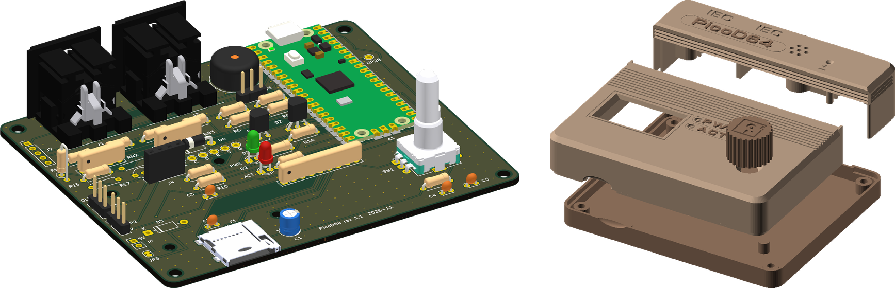
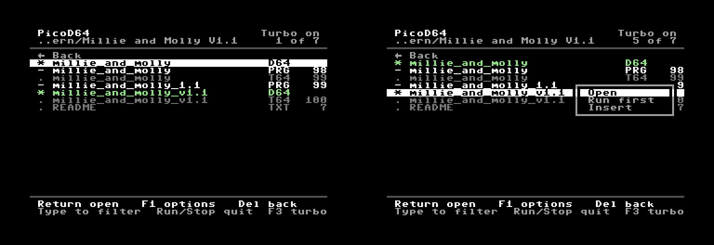
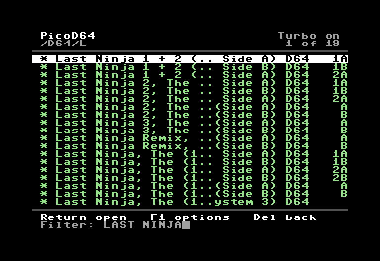

# PicoD64: a cycle-exact 1541 emulator you can build

-0369a1)

PicoD64 replaces a Commodore 1541 disk drive, using a Raspberry Pi Pico 2. It doesn't imitate
the drive's behaviour from the outside: it **emulates the 1541's electronics**. The drive's 6502,
its two 6522 VIAs and the GCR data path to the head are emulated cycle by cycle, in lockstep at
1 MHz, and they run the 1541's own DOS ROM, which you supply. Disk images come from a microSD
card, and it plugs into the C64's serial (IEC) port like a drive. Because the DOS and any drive
code a program uploads run cycle for cycle, fast loaders behave as they do on a 1541: demanding demo loaders
run on a real C64 (see [Compatibility](#compatibility)).

It is designed to be cheap and easy to build: a small board, almost all through-hole (the
microSD socket and the Pico 2's castellated edge are surface-soldered), a Pico 2, a 1.3" OLED,
a rotary encoder and a 3D-printed case.

> **Free for private and commercial use.** PicoD64 is a hobby project, given to the community.
> Build one, sell them, improve them; if you change it, share your changes under the same terms
> (see [Licence](#licence)). If it's useful to you, please consider
> [supporting it on Ko-fi](https://ko-fi.com/bitbarista). It funds the prototypes and test hardware.
>
> **Ordering boards?** Signing up to JLCPCB through [this referral link](https://jlcpcb.com/?from=PBTJYEXOJNFQR) costs you nothing
> extra and earns the project a small credit towards new prototypes.

  

## Download

Click a link and the file downloads; there's no need to find your way round GitHub.

| | |
|---|---|
| **Firmware** | [**picod64.uf2**](https://github.com/bitbarista/picod64/releases/latest/download/picod64.uf2): copy it onto the Pico (see [Firmware and SD card](#firmware-and-sd-card)). |
| **The 1541 ROM for the SD card** | The [**card setup page**](https://bitbarista.github.io/picod64/fw/tools/card-setup.html) fetches it, checks it and saves it for the card. |
| **The board** | [**picod64-rev1.1-gerbers.zip**](https://github.com/bitbarista/picod64/releases/latest/download/picod64-rev1.1-gerbers.zip): send this file to a PCB maker as it is. |
| **The case** | [**picod64-case-stl.zip**](https://github.com/bitbarista/picod64/releases/latest/download/picod64-case-stl.zip): every part to print, as STL files. |
| **Using it** | The [**user guide**](docs/USER-GUIDE.md): the browser, the knob and OLED, and multi-disk games, with pictures. |
| **Building it** | The [**interactive BOM**](https://bitbarista.github.io/picod64/hardware/fab/picod64-ibom.html) shows where each part goes; [`hardware/BUILD-NOTES.md`](hardware/BUILD-NOTES.md) is the step-by-step guide. |
| **Everything** | [**The whole project as one zip**](https://github.com/bitbarista/picod64/archive/refs/heads/main.zip): the source, the parts lists and all the documents. |

Older versions and the notes for each are on the [Releases page](https://github.com/bitbarista/picod64/releases).

## Highlights

| | |
|---|---|
| **Change disks with one hold of the knob.** For multi-disk games and demos: hold the knob and PicoD64 swaps to the next disk of the set, as you'd swap floppies, and the C64 carries on. The OLED shows which disk is in (`2/3`). | **A knob and display on the drive.** Insert, swap and eject disks, make a new blank one, or set the device number, without touching the C64. Everything the browser does is shown there too. See the [user guide](docs/USER-GUIDE.md). |
| **The 1541's electronics, emulated.** The drive's 6502, VIAs and GCR path are emulated cycle by cycle, running the 1541's own DOS ROM. Fast loaders and drive code should behave as they do on a 1541. | **Cheap and easy to build.** A Raspberry Pi Pico 2 and common parts, almost all through-hole, with ready-made Farnell and LCSC order files. No programmer: flash it by copying one file over USB. |
| **An all-new browser, built in.** Nothing to install on the card or the C64: `LOAD"*",8`, `RUN`. Full upper/lower-case names, a format column, multi-disk sets told apart, type to filter, keyboard or joystick. | **Turbo loading, ~27× faster.** About 11 KB/s with no drive code, and it falls back to a plain load on any error. One key turns it off for awkward or copy-protected titles. |
| **A case designed for it.** A 3D-printed case made to fit this board, with C64-style ribs, shoulders and printed badges, including a PWR/ACT badge like the breadbin's POWER badge. Prints without supports or a brim, and every part is fit-checked against it. | **Writes for real.** SAVE, scratch and format go back into the D64 on the card. With no disk mounted, `SAVE` writes a PRG and `N:` makes a new blank disk. |
| **Sounds like a 1541.** A piezo plays the head stepping, the head bump knock and the motor, driven by what the emulated drive is doing. | **Fits in with what you have.** A second IEC socket daisy-chains on to other drives, device 8–11. Made for FB64 and FB64 Turbo, and for JiffyDOS with your own ROM (both pass the PC tests; not yet confirmed on a real C64). |

**Open.** Hardware CERN-OHL-W, code GPL-3.0. Written clean-room from datasheets and Commodore's own documents, with every source listed.

**Proven on a real C64:** the drive and its DOS, the browser and its turbo, and a list of demanding demo loaders and the 1541 Testsuite (see [Compatibility](#compatibility)). JiffyDOS (KERNAL, and KERNAL plus drive ROM) is proven on a real C64 too. FB64 and the turbo's speed figure come from the PC tests so far: [Status](#status-rev-11-november-2026) says what is proven where.

## What it does

In detail.

- **The 1541, emulated cycle for cycle.** Every cycle of the drive's 6502 and VIAs is emulated, in
  lockstep with the IEC bus, running the stock DOS ROM (325302-01 + 901229-05) that you supply on the card.
  SAVE, scratch and format work, and what you write goes back into the D64 on the card. With no disk
  mounted, `SAVE` writes a PRG to the card, and `N:NAME,ID` makes a new blank D64. The knob's **Settings** has **New disk** too.
- **D64 images from microSD**, up to 42 tracks. FAT32 or exFAT, any size, folders anywhere. A mounted image is
  streamed to GCR a track at a time. Written tracks go back to the file when the motor stops,
  before a disk swap or an eject, and when the card-detect switch sees the card being pulled
  (eject first to be safe).
- **Browse mode.** With no disk mounted, the C64 sees the card itself: `LOAD"$",8` lists the
  folder, `.PRG` files load directly, and you `CD` into a folder or a D64 to mount it.
- **A built-in browser for the C64.** `LOAD"*",8` then `RUN`, or `LOAD"BROWSER",8` the plain way. Full
  names in upper and lower case, with a column showing each file's format, so `game.d64`, `game.prg` and
  `game.crt` can be told apart, and a footer that says what RETURN will do. Keyboard or joystick in port 2:
  cursor keys and RETURN, type to filter, DEL for back, F1 for options (Run, Load, Run slow; for a disk Open,
  Run first, Insert), RUN/STOP to quit. Folders of any size; up to 2,048 entries are listed, and the filter
  reaches the rest. It remembers the turbo setting, the folder and the position on the card.
- **A turbo for the browser.** Programs (PRG files) on the card load at about 11 KB/s, ~27× stock (on
  the PC twin), with no drive code. Programs inside a D64 load the normal 1541 way, through the drive, so the
  drive has read the disk as a real one would. F3 turns it off, F1 Run slow skips it once, and any wrong byte falls
  back to a plain LOAD.
- **FB64 file browsers.** Made to work with Jani's **FB64** (FB v2.0), its fast-loader version
  **FB v2.0FL**, and **FB64 Turbo** ([CSDb 223021](https://csdb.dk/release/?id=223021)): browsing,
  mounting and loading, including FB64 Turbo's turbo loads from a D64 or a PRG. All three pass on
  the PC against the real KERNAL; the first board will try them on a real C64.
- **Display and knob.** A 1.3" OLED shows the folder and the mounted disk. The knob scrolls, pushes
  to mount and ejects. **Settings** is the last line of the list, one click back from the top. A **long press mounts the next disk of a set** (`disk1`, `side a`,
  `1a`, `(Disk 1 of 3)` and similar names), for multi-disk games and demos. A green PWR and a red ACT
  LED, the 1541's colours, stand proud of the lid.
  **Try it before you build:** [open the front panel demo](https://bitbarista.github.io/picod64/host/panel-demo/panel-demo.html)
  in your browser. It runs the real knob and OLED code, in a picture of the case. To keep a copy that works offline,
  download [`panel-demo.html`](host/panel-demo/panel-demo.html) and open it.
- **Daisy chain.** Two IEC sockets wired in parallel: one to the C64, one on to the next device.
  The device number can be set to 8–11: hold the knob at power-on, turn, press. It is shown on the OLED.
- **It sounds like a 1541.** A small piezo plays the head stepping, the knock of a head
  bump and the motor, driven by what the emulated drive is really doing. *Sound* in the knob's **Settings** turns it off.
- **Powered by USB.** An optional header takes 5 V from the C64's datasette port instead, but
  that port is rated for only about 100 mA, so whether it is enough is still to be measured.

## The built-in browser

There's nothing to install or copy to the card, and nothing to add to the C64. It's in the firmware: `LOAD"*",8`, then `RUN`.

- **Fast.** Programs load at about 11 KB/s, roughly 27 times stock, with no drive code. It's measured on the PC test setup so far, not yet on a real C64.
- **You can see what you're choosing.** Full names in upper and lower case. A format column tells `game.d64` from `game.prg` and `game.crt`, and a footer says what RETURN will do.
- **Which disk is which.** A column reads the disk and side from the name, so a long name's `(Disk 1 of 2 Side A)` shows as `1A` even when the row has to shorten it.
- **Made for real collections.** A folder of 802 long names opens in about 0.75 s on the test setup, with up to 2,048 entries listed in order. Type a few letters to filter, including entries past that limit.
- **Keyboard or joystick.** Cursor keys and RETURN, DEL for back, F1 for options (Run, Load, Run slow; on a disk Open, Run first, Insert), F3 for the turbo. It's all on screen, so there's nothing to memorise.
- **Remembers where you were.** The folder, your position and the turbo setting are kept on the card.
- **Fits in with what you have.** It's designed to start with a fast-load cartridge fitted, runs with a JiffyDOS KERNAL on the test setup, and works on a plain 1541 too. FB64 and others still work if you prefer them: none of this needs the browser.

## Status (rev 1.1, November 2026)

- **The first board is built and works with a real C64.** Rev 1.1 is the same board with the new name on the
  silkscreen; copper and drill files are identical ([`hardware/AUDIT.md`](hardware/AUDIT.md) R25).
- **The emulator is proven on the PC.** The 6502 passes Klaus Dormann's functional test and is
  bus-identical, cycle by cycle, to perfect6502. The stock DOS boots exactly as in VICE. The
  real C64 KERNAL lists and loads from it over a simulated IEC bus, byte-identical to VICE.
  Writes are read back correctly by VICE's `c1541`.
- **The board firmware is built and host-tested.** The drive runs in real time on a Pico 2
  (lockstep at 150 MHz). The whole board code (SD, FatFs, browse mode, mount, write-back,
  fast-loader handling, knob, OLED) is tested on the PC against the real KERNAL and a simulated
  SD card ([`host/fwtwin.sh`](host/fwtwin.sh), over 100 checks).
- **On a real C64, at the stock 150 MHz:** the DOS, the browser and its fast loader, and demanding demo loaders
  (The Hat, Edge of Disgrace, MATH, each through every disk), checked against a real-timing drive on the same C64
  with a bus sniffer. [`FIRMWARE.md`](FIRMWARE.md) has the measurements and the known issues.
- **The case is printed:** the split lid, C64-style details, badges and knob are confirmed by print. A fit check of
  every part on the assembled board against the case passes ([`case/check_fit.py`](case/check_fit.py)).

**Still to measure:** power from the datasette port; more fast loaders and games.

**Known limits.** D64 images of 35, 40 and 42 tracks. A D64's error bytes are built into the disk, so the DOS
finds each read error where the original disk had it; the write errors they can record are not. No G64, no D71/D81. The 6502's undocumented opcodes pass the 1541 Testsuite; its IRQ/SO edge
timing is not yet checked against perfect6502.

## Compatibility

Tested on a real **PAL** C64 with the stock 150 MHz firmware, PicoD64 the only device on the serial bus, each
title from a freshly powered-up C64 and run to its end (or its own pass screen):

- **Demos and their loaders:** Coma Light 13 (Krill's loader), Dutch Breeze, Edge of Disgrace and Uncensored
  (Booze Design), Lunatico and Shards of Fancy (Spindle), MATH, Memento Mori (Sparkle), Primitive 7 Sins,
  Reanim8ed (Dasheles' loader), The Hat, The Masque, Transwarp (the fastest loader about), Wonderland XIV (40
  tracks), Mafio-DOS.
- **The drive's CPU:** the 1541 Testsuite (r192), all 219 tests.
- **The browser and its turbo,** loading PRGs (turbo) and D64s (the normal 1541 way) from the card.

That is a sample, not every program. PicoD64 is checked against a real 1541 wherever we could, but **we can't
be sure everything runs**: some loaders are famously picky, and there are thousands of titles.
[`docs/COMPAT-TESTS.md`](docs/COMPAT-TESTS.md) has the list, with each title's loader and disks. Some fast loaders fail with another drive
or interface on the serial bus, on a real 1541 too: if one fails, try PicoD64 as the only device.

**PAL only so far.** Every test was on a PAL C64. PicoD64 is designed for NTSC too (the drive runs on its own 1 MHz
clock, as a 1541 does, and the browser's turbo allows for both C64 clocks), but it has **not been tested on an NTSC
C64**. Reports from NTSC owners are welcome (the bug report link below).

**If something doesn't work, please [open an issue](https://github.com/bitbarista/picod64/issues/new?template=bug_report.md).**
Say what you ran (title, group, and a CSDb link or where the image came from), how you started it (the browser,
`LOAD"*",8,1`, a cartridge), what happened and when, and which firmware ([`firmware/VERSION.txt`](firmware/VERSION.txt)). If you have a
real 1541 or another drive to hand, whether it works there helps a lot.

## How it works

- **Two cores.** Core 1 owns the IEC pins and nothing else. It runs either browse mode or the
  emulated 1541, from SRAM, in lockstep with the bus. Core 0 owns the SD card, the OLED, the
  knob, the LEDs and the piezo. When browse mode needs the card, core 1 holds the bus busy, as a
  real drive does, while core 0 does the work.
- **The ATN acknowledge in PIO.** A real 1541 answers ATN with an XOR gate, in nanoseconds. Some
  fast loaders, FB64 Turbo among them, check for the answer 4 µs later, too soon for software,
  so a PIO state machine ([`fw/atn_gate.pio`](fw/atn_gate.pio), 5 instructions) answers instead. Measured on the
  bus of a real C64: DATA follows an ATN edge 0.17 µs later when pulled, 0.42 µs when released (the
  line's slower rise); a 1541 on the same C64, 0.25 µs.
- **Fast loaders from browse mode.** When a C64 program uploads drive code in browse mode,
  PicoD64 builds a disk on the card, boots the emulated 1541 with its DOS, replays the conversation
  into it, then hands the bus to the emulated drive.
- **White-coat design.** PicoD64's own code is written from primary documentation: datasheets,
  Commodore's documents and the ROM itself. Other implementations, VICE among them, are used
  only as black-box oracles to compare results against. [`PROVENANCE.md`](PROVENANCE.md) lists every source and
  the few exceptions (FB64 Turbo's source was read, for compatibility only). Third-party code,
  FatFs, keeps its own licence ([`THIRD-PARTY.md`](THIRD-PARTY.md)).

## Building one

1. **Order the board** from JLCPCB ([referral link](https://jlcpcb.com/?from=PBTJYEXOJNFQR)) or
   any fab: [`picod64-rev1.1-gerbers.zip`](https://github.com/bitbarista/picod64/releases/latest/download/picod64-rev1.1-gerbers.zip) (also in [`hardware/fab/`](hardware/fab/)), 2 layers, 1.6 mm.
2. **Buy the parts:** [`hardware/fab/BUY.md`](hardware/fab/BUY.md), with a ready-made Farnell upload file in [`hardware/fab/`](hardware/fab/). Farnell
   is the tested source; an LCSC file is there too, but it has never been ordered. The full BOM, with the optional parts, is [`hardware/fab/BOM.md`](hardware/fab/BOM.md).
3. **Solder it.** Almost everything is through-hole. The interactive BOM
   ([open it](https://bitbarista.github.io/picod64/hardware/fab/picod64-ibom.html), or download
   [`hardware/fab/picod64-ibom.html`](hardware/fab/picod64-ibom.html) and open it in a browser)
   shows where each part goes and lets you tick parts off as you fit them. The Pico 2 is soldered flat by its
   castellated edge, and the microSD socket is surface-mount, with every tail reachable by an iron.
   **[`hardware/BUILD-NOTES.md`](hardware/BUILD-NOTES.md) is the step-by-step build:** fit order, polarities, LED standoffs, the OLED,
   the first test, printing and assembling the case.
4. **Print the case:** every file in [`picod64-case-stl.zip`](https://github.com/bitbarista/picod64/releases/latest/download/picod64-case-stl.zip) (the same as [`case/stl/`](case/stl/)), as exported, with **no brim** and no supports
   ([`hardware/BUILD-NOTES.md`](hardware/BUILD-NOTES.md), step 6). The badges print best in two colours: change filament
   at the letters. The set includes a small **knob seating tool**: push the knob onto it once before fitting it, so its
   first, firm push is on the bench and not on the encoder ([`hardware/BUILD-NOTES.md`](hardware/BUILD-NOTES.md), step 7).
5. **Flash the firmware and prepare the card** (below).

### Firmware and SD card

- **Flash:** hold the Pico's BOOTSEL (in the case: press the pinhole marked ⤓ with a paperclip),
  plug in USB, and copy [**picod64.uf2**](https://github.com/bitbarista/picod64/releases/latest/download/picod64.uf2) (click to download; it's also [`firmware/picod64.uf2`](firmware/picod64.uf2)) onto
  the **RP2350** drive that appears.
- **Updating, once flashed:** copy the new `picod64.uf2` to the card's top folder and switch on. PicoD64
  checks it, installs it (the OLED says *Updating, wait*, then *Updated*) and renames it
  `picod64.uf2.done`. Don't switch off while it updates; if that ever happens, flash it with BOOTSEL as above.
- **SD card:** any size, formatted FAT32 or exFAT. Put your disk images (`.d64`) and programs
  (`.prg`) on it, in folders if you like.
- **The 1541 DOS ROM.** PicoD64's emulated 1541 runs the drive's own operating system, so it needs a
  copy of the drive's ROM. The ROM is Commodore's copyright, so PicoD64 can't include it; you put it on the
  card yourself. The ROMs are archived at [zimmers.net](https://www.zimmers.net/anonftp/pub/cbm/firmware/).
  - **The easy way, any computer:** open the **[card setup page](https://bitbarista.github.io/picod64/fw/tools/card-setup.html)**
    and click *Get the 1541 ROM*. It fetches the ROM from zimmers.net, joins and checks it, and saves `dos1541.bin`
    for the card (in Chrome or Edge, straight onto the card). It takes your own copy instead if you have one, and
    can add the Commodore font for the OLED too. Nothing to install, and the page holds no ROMs. It also works
    downloaded: save [`card-setup.html`](fw/tools/card-setup.html) and open it in a browser.
  - **Windows, with a script:** download [`get-roms.ps1`](fw/tools/get-roms.ps1), open **PowerShell**
    in the folder you saved it to, and run (with your card's drive letter):

        powershell -ExecutionPolicy Bypass -File get-roms.ps1 E:\

    It downloads the ROMs, joins and checks them, and writes them to the card.
    (`-ExecutionPolicy Bypass` lets this one script run; Windows blocks downloaded scripts by default.)
  - **Windows, by hand:** download the two halves of the 1541 ROM,
    [`1541-c000.325302-01.bin`](https://www.zimmers.net/anonftp/pub/cbm/firmware/drives/new/1541/1541-c000.325302-01.bin)
    and [`1541-e000.901229-05.bin`](https://www.zimmers.net/anonftp/pub/cbm/firmware/drives/new/1541/1541-e000.901229-05.bin),
    open **Command Prompt** (not PowerShell: there `copy` works differently) in the folder they are in, and join them:

        copy /b 1541-c000.325302-01.bin + 1541-e000.901229-05.bin dos1541.bin

    Copy `dos1541.bin` to the top folder of the card.
  - **Linux or macOS:** `bash fw/tools/get-roms.sh /path/to/the/card` does the same as the Windows
    script. By hand: `cat 1541-c000.325302-01.bin 1541-e000.901229-05.bin > dos1541.bin`.
  - It must be exactly **16,384 bytes**, MD5 `a0ce8439d1b8dcf2e1430461f7233a72`: that is the ROM
    PicoD64 is tested with (on Windows, `certutil -hashfile dos1541.bin MD5` shows it). If the file is
    missing or the wrong size, the OLED shows *Need /dos1541.bin*.
- **Optional: a different font on the OLED.** It comes with a C64-style font, and you can change it by
  adding one file to the top folder of the card:
  - **A plainer font, same size:** copy [`fw/fonts/font5x7.bin`](fw/fonts/font5x7.bin) to the card.
  - **The Commodore font itself:** this one is wider, so names get 14 characters instead of 19. The card setup
    page adds it (step 2), or put the C64's character ROM,
    [`characters.901225-01.bin`](https://www.zimmers.net/anonftp/pub/cbm/firmware/computers/c64/characters.901225-01.bin),
    on the card renamed **`chargen.bin`**. The scripts don't add it. If both files are there, this one wins.
- **Optional, for JiffyDOS owners:** if your C64 has the JiffyDOS KERNAL and you own the JiffyDOS
  1541 ROM, put that ROM (16,384 bytes) on the card as `dos1541.bin` instead. Mounted D64s then
  load at JiffyDOS speed: on a real C64, a 154-block file took 18-20 s instead of about 100 s, every
  byte checked ([Compatibility](#compatibility)). Not included, because JiffyDOS is a commercial product.

### Building from source

- **Firmware:** `bash fw/build.sh` builds `fw/build/picod64.uf2` (the release's [`firmware/picod64.uf2`](firmware/picod64.uf2) is that file). It needs the Raspberry Pi Pico
  SDK and the Arm GNU toolchain.
- **Host checks:** `sh host/check.sh` runs every emulator and firmware check on the PC. It needs
  Klaus Dormann's functional test, perfect6502 and the C64/1541 ROMs, which are not included;
  the scripts say where they look.
- **Hardware:** the KiCad 9 project is in [`hardware/`](hardware/), generated by [`hardware/gen/`](hardware/gen/): the
  schematic by `gen/check_sch.sh`, the board by `gen/board.sh` (with Freerouting), the order
  files by `gen/fab.py`, and the interactive BOM by `gen/ibom.py` (it needs InteractiveHtmlBom; the
  script says how to install it). The makers' 3D models of the sockets and encoder can't be
  redistributed, so they are not included: `bash hardware/lib/3d/fetch.sh` gets them.
- **Case:** [`case/picod64-case.scad`](case/picod64-case.scad) (OpenSCAD). Use **Window > Customizer** for the fit,
  screws, walls, labels and knob, then run `bash case/export.sh` to re-export and re-check every
  part. The scripts read the values written in the scad, not Customizer presets.
  - **Font:** the labels use **Eurostile**, a commercial font that is not included. Without it,
    OpenSCAD silently uses another font and the letter spacing goes wrong. To use a font you
    have, run `bash case/gen_glyphs.sh "Your Font"`, set `LABEL_FONT` at the top of the scad,
    then run `bash case/check_labels.sh`. Wide, squared fonts suit the case; free examples are
    Michroma and Orbitron.

## Documents

| File | What |
|---|---|
| [`docs/USER-GUIDE.md`](docs/USER-GUIDE.md) | Using it: the browser, the knob and OLED, multi-disk games |
| [`hardware/BUILD-NOTES.md`](hardware/BUILD-NOTES.md) | Building it: soldering, OLED, printing the case, screws, firmware and SD card |
| [`FIRMWARE.md`](FIRMWARE.md) | The firmware: test gates, results, the board firmware's design and status |
| [`hardware/AUDIT.md`](hardware/AUDIT.md) | The design audit: every decision and check, with its evidence |
| [`case/CASE.md`](case/CASE.md) | The case: printing, customising, and its design history |
| [`PROVENANCE.md`](PROVENANCE.md) | Sources for every factual claim in the design |
| [`THIRD-PARTY.md`](THIRD-PARTY.md) | Third-party material: what is included, what isn't, and why |

| Folder | What |
|---|---|
| [`core/`](core/) | The emulator: `cpu6502.h`, `via6522.h`, `drive1541.h`, browse mode. Shared by the PC checks and the Pico |
| [`fw/`](fw/) | The board firmware |
| [`host/`](host/) | PC checks: Klaus test, perfect6502 bus comparison, DOS boot, IEC, the firmware twin |
| [`bench/`](bench/) | The feasibility firmware for a bare Pico 2 |
| [`hardware/`](hardware/) | KiCad project, generators, fab files |
| [`case/`](case/) | The 3D-printed case: OpenSCAD source, STLs, checks, renders |

## Not in this release

This repository is the release: everything needed to build PicoD64, change it and test it. The development
history stays in the project's own repository: superseded case designs and test prints (`archive/`, which
`case/CASE.md` and `hardware/AUDIT.md` mention), a styling study, the rev 1 fab files as ordered (rev 1.1 has the
same copper), and the early feasibility notes and hardware proposal.

## Support the project

PicoD64 took a lot of design and test work, and prototype boards cost money. If you build one,
a coffee on Ko-fi is very welcome:

New to JLCPCB? Signing up through [this referral link](https://jlcpcb.com/?from=PBTJYEXOJNFQR) also helps: it earns the project
a small credit towards new prototypes, at no cost to you.

## Disclaimer

PicoD64 is a hobby project, provided as is, without warranty of any kind. Building it and using
it are at your own risk. The author accepts no responsibility for damage to your C64, your
drives or other hardware, for lost or corrupted disk images or data, or for any other loss.

- **Switch the C64 and other drives off** before connecting or disconnecting the serial (IEC)
  cable.
- **Keep copies of your disk images.** PicoD64 writes to the D64 files on the card. A firmware
  fault, a card pulled while writing or a power cut can damage them.
- **ROMs and software are yours to supply.** PicoD64 includes no Commodore ROMs and no games.

The full terms are in the licences below.

## Licence

© 2026 Carl Leach. Free for private and commercial use. **Modifications must be shared under the
same terms**: if you distribute a changed design, firmware or document, its source goes with it
under the same licence.

- **Hardware and case design** ([`hardware/`](hardware/), [`case/`](case/)): [CERN-OHL-W v2](LICENSES/CERN-OHL-W-2.0.txt)
- **Emulator, firmware, tools and checks** ([`core/`](core/), [`fw/`](fw/), [`host/`](host/), [`bench/`](bench/), [`hardware/gen/`](hardware/gen/),
  and the scripts): [GPL-3.0-only](LICENSES/GPL-3.0.txt)
- **Documentation:** [CC BY-SA 4.0](LICENSES/CC-BY-SA-4.0.txt)

Third-party code keeps its own licence: FatFs by ChaN ([`fw/fatfs/`](fw/fatfs/)), the Bescii font (CC0,
[`fw/fonts/bescii/`](fw/fonts/bescii/)), footprints adapted from the KiCad libraries (CC BY-SA 4.0) and the Raspberry
Pi Pico SDK (BSD-3-Clause, fetched at build time). [LICENSE.md](LICENSE.md) says which licence
covers which folder; [THIRD-PARTY.md](THIRD-PARTY.md) has the details.

*Not affiliated with, or endorsed by, any holder of the Commodore trademarks, or Raspberry Pi Ltd.*
