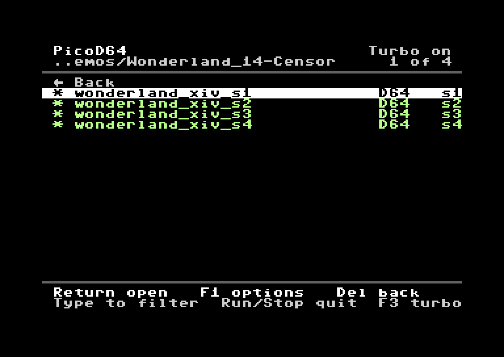
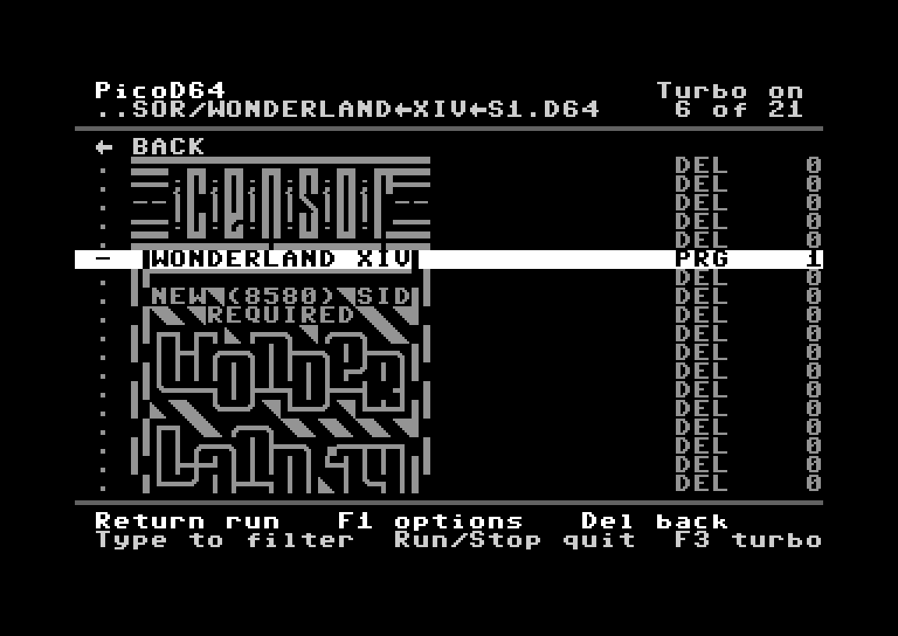
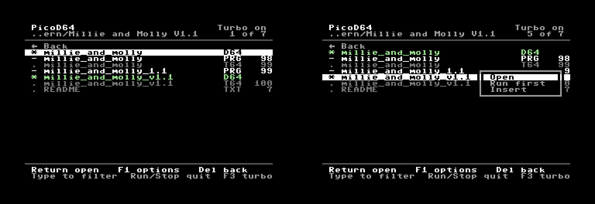
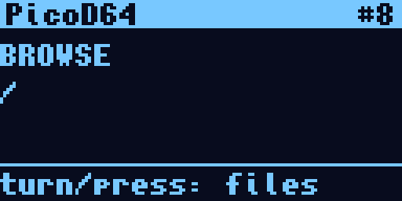
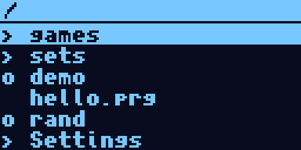
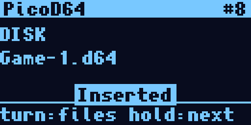
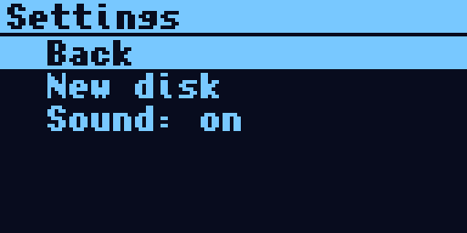
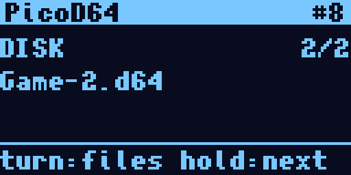

# Using PicoD64

PicoD64 has two ways in: the **browser** on the C64's screen, and the **knob and OLED** on the drive itself. Use
whichever suits: they work together, and anything one puts in the drive, the other shows.

- [The browser](#the-browser): pick and run games and programs from the C64.
- [The knob and OLED](#the-knob-and-oled): insert, swap and eject disks without touching the C64.
- [Multi-disk games and demos](#multi-disk-games-and-demos): one long press for the next disk.
- [Without either](#without-either-plain-basic): plain BASIC commands still work.

## The browser

Nothing to install. With no disk in the drive, type:

```
LOAD"*",8
RUN
```

The browser opens on the card, where you last left it.



**Reading the screen**

- Each line is marked: `>` a folder, `*` a disk, `-` a program, `.` a format that can't run from here. Then its **format**
  (D64, PRG, CRT, T64, TXT...) and, for disks of a set, **which disk** it is (`1A`, `s2`, ...).
- The top line shows where you are and whether the **turbo** is on; the bottom lines say what RETURN will do here.

**Keys**

| Key | What it does |
|---|---|
| Cursor up / down | Move |
| **RETURN** | Run the program, open the folder, or open the disk |
| Just type | **Filter** the list to names containing what you typed |
| **DEL** | Back: out of a disk or folder (while filtering, rubs out a letter) |
| **F1** | Options for this entry (below) |
| **F3** | Turbo on or off (remembered) |
| RUN/STOP | Clears the filter; otherwise back to BASIC |

**Joystick in port 2:** up and down move, left is back, right or a tap of fire is RETURN, and holding fire is F1.

**F1 options**

| On a program | On a disk |
|---|---|
| **Run**: load and run it (the same as RETURN) | **Open**: show its files (the same as RETURN) |
| **Load**: load it and stop at READY | **Run first**: put the disk in and run its first program, as `LOAD"*",8,1` + `RUN` |
| **Run slow**: load it the normal 1541 way, once (for programs that don't like the turbo) | **Insert**: put the disk in the drive and go to BASIC |

**Inside a disk**, the browser shows its directory the way the C64 would, so directory art comes out as the group
drew it. RETURN on a program runs it.



**Good to know**

- **The turbo** loads programs about 27 times faster than a normal 1541, with nothing extra on the C64. If anything
  goes wrong it quietly falls back to a normal load. For an awkward title, F1 **Run slow**, or F3 to turn it off.
- **It remembers** the folder, your place in it and the turbo setting, even after the C64 is switched off.
- **Big folders** are fine: up to 2,048 entries are listed, and the filter finds any of them.
- **A fast-load cartridge** can stay fitted.



## The knob and OLED

The knob **turns**, **presses** (a click) and **holds** (press and keep it down for most of a second). After 15
seconds untouched, the display goes back to its first screen.

### The first screen: what's in the drive



It shows the device number and either **BROWSE** and the folder (no disk in: the C64 sees the card, and the
browser works), or **DISK** and the disk's name. The bottom line reminds you what the knob does here.

- **Turn or press**: the file list.
- **Hold**: the next disk of a set (see [Multi-disk](#multi-disk-games-and-demos)).

### The file list



Folders are marked `>`, disks `o`. Turn to move; the list goes round at the ends.

| Press on | What happens |
|---|---|
| A folder | Opens it (`..` at the top goes up) |
| A disk (D64) | **Inserts it**: the C64 now has that disk in drive 8 |
| A program (PRG) | Makes it ready to load: type `LOAD"*",8,1` on the C64 |
| **Eject** (at the top while a disk is in) | Takes the disk out |
| **Settings** (the last line) | The settings |

**Hold** to go back to the first screen.



A disk you insert with the knob **stays in when the C64 is reset**, as a real disk would. (One the browser put in
comes out on a reset, so `LOAD"*",8` brings the browser back.)

### Settings



- **New disk**: makes a new, blank, formatted D64 in the folder you were in (`New disk 01.d64`, then 02...) and
  inserts it, ready to save to.
- **Sound**: the drive sounds (head steps, the head knock, the motor) on or off.

### The device number

PicoD64 is drive 8 to start with. For 9, 10 or 11: **hold the knob down while powering on**, turn to the number,
press to save. It's shown at the top right of the first screen.

## Multi-disk games and demos

When a game or demo asks for the next disk, **hold the knob** on the first screen. PicoD64 swaps to the next disk
of the set, the way you'd swap floppies: the C64 sees the disk change and carries on.



A **set** is the disks in one folder whose names differ only in their number or side: `disk1`, `side a`, `1a`,
`(Disk 1 of 3)` and the like. The OLED shows where you are (`2/3`), and after the last disk comes the first again.
No set? The long press takes the next disk in the folder.

The browser shows the same sets, with each disk's number in its own column, so you can see which is which.

## Without either: plain BASIC

PicoD64 is a 1541 to the C64, so the usual commands work as they would on a real drive. With no disk in, it shows
the card itself:

| Type | What happens |
|---|---|
| `LOAD"$",8` then `LIST` | The folder on the card |
| `LOAD"NAME",8` | Loads `name.prg` from the card's folder |
| `OPEN15,8,15,"CD:FOLDER":CLOSE15` | Into a folder (`CD_` back up, `CD//` the top) |
| `OPEN15,8,15,"CD:GAME.D64":CLOSE15` | Inserts that disk |
| `SAVE"NAME",8` | Saves a program to the card |
| `OPEN15,8,15,"N:NAME,ID":CLOSE15` | Makes a new blank disk, `name.d64`, and inserts it |

With a disk in, everything goes to the disk, as on a 1541: `LOAD"*",8,1`, `SAVE`, and fast loaders. Saves and
formats are written back to the D64 on the card.
